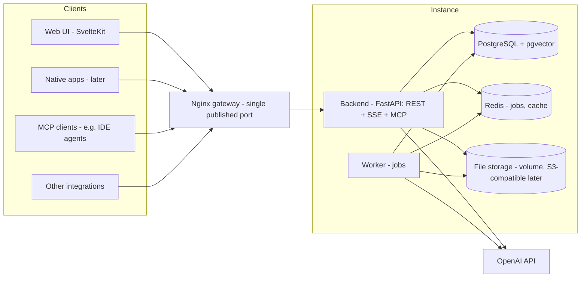

# Fidus — Architecture Overview

Status: the scaffold is implemented (Compose stack, auth, module registry, row-level security, worker, web shell). Chat, files, tasks, audio, tokens, the MCP server and everything else below are design only. Update this file together with the code.

## 0. Implemented in the scaffold
- Compose services: `gateway`, `frontend`, `backend`, `worker`, `db`, `redis` and the one-shot `migrate` service that `backend` and `worker` wait for. Networks: `edge` (gateway only), `internal` (no outbound route), `egress` (backend and worker, for the OpenAI API).
- Auth: fastapi-users with an opaque, random token in an httpOnly, SameSite=Lax cookie (`fidus_session`) and a readable double-submit CSRF cookie (`fidus_csrf`). Only the token's SHA-256 hash is stored in the database. State-changing requests carrying a session cookie must echo the CSRF token in `X-CSRF-Token`; the Origin check against `APP_URL` remains in place. Login sets both cookies and logout clears both and deletes its session row, so a stolen session token is immediately revoked at logout. Sessions also expire after `session_lifetime_seconds` (14 days); expired rows can be purged by the `sessions.purge_expired` worker job, which is not scheduled yet. The first registered user becomes admin (`is_superuser`, exposed as `role`); registrations are serialized with an advisory lock. `REGISTRATION_MODE=closed` rejects further registrations; `invite-only` requires an admin-created invitation after the first user. Invitation tokens are shown once, stored as SHA-256 hashes, and expire after a configurable period (7 days by default, at most 30). Admins manage invitations through the API for now; there is no admin screen.
- Login and registration are rate limited by client IP and account identifier using Redis fixed-window counters (`AUTH_RATE_LIMIT_ATTEMPTS`, `AUTH_RATE_LIMIT_WINDOW_SECONDS`). Identifiers are salted and hashed before becoming Redis keys. If Redis is unavailable, authentication fails open and a generic warning is logged so an outage does not prevent sign-in; this means rate limits are temporarily unavailable during that outage.
- Not implemented yet: API tokens, OAuth, and user management screens.
- Row-level security: `users` and `sessions` are intentionally not row-level-secured, because authentication has to look them up before any user context exists. The application role may only select, insert and update `users`, and only select, insert and delete `sessions`. `tasks` and `invitations` are user-owned tables with forced policies. `module_settings` is instance-wide, has no `user_id` and intentionally no RLS policy; the application role may select, insert and update it. `app.user_id` is set with `set_config(..., true)`, the parameterizable form of `SET LOCAL`. The `migrate` service creates or refreshes the application role (`APP_DB_USER`, `APP_DB_PASSWORD`) before running Alembic.
- Worker: taskiq with a Redis list broker, same image as the backend. The example job `tasks.count_open` runs inside the owning user's context. A Taskiq lifecycle hook refreshes a short-lived Redis heartbeat; the worker healthcheck requires a fresh heartbeat and verifies that Redis and the database answer.
- Modules: `GET /api/v1/modules` returns enabled registry entries for the session user; the sidebar renders them. Admins manage instance-wide enablement and invitations in `/admin`. Disabled modules are hidden from this endpoint and route dependencies can block their APIs; worker jobs can use `ensure_module_enabled`, but no job calls it yet. Chat, files and tasks are placeholders without screens or services. Disabling a module leaves its data untouched.
- Frontend: SvelteKit with adapter-node, server-side load of the user and modules, a generated OpenAPI type schema used by a shared `openapi-fetch` client, German and English catalogs with a typed key set.


## 1. Goals and constraints
- Web interface first. Native apps (macOS, iOS, iPadOS, Windows) come later as clients of the same API.
- Self-hostable in two ways with the same artifacts: locally on a developer machine, and on an own server or web hosting with Docker.
- Multiple users on one instance, with strict data separation.
- An MCP server and a documented REST API for later integrations.
- One instance-level OpenAI API key; models fixed in a config file.
- In-app reminders only.

## 2. System context



## 3. Components

| Component | Responsibility | Technology |
| --- | --- | --- |
| Gateway | Single host port, TLS (external proxy or certificates mounted into the gateway), routes `/` to the frontend, `/api` and `/mcp` to the backend; proxy buffering disabled and long timeouts for SSE | Nginx |
| Frontend | Web UI, generated TypeScript API client, i18n DE/EN; runs as its own container behind the gateway | SvelteKit (Node server), TypeScript |
| Backend | REST API, SSE streaming, MCP endpoint, auth, services | FastAPI, SQLAlchemy async, Alembic |
| Worker | Transcription, text extraction, chunking, embedding, reindexing, reminder scheduling | same codebase as backend, separate process (taskiq on Redis) |
| Database | Relational data, full-text search, vectors | PostgreSQL + pgvector |
| File storage | User files, uploaded audio, attachments | local volume behind a storage interface; S3-compatible adapter later |
| Job queue and cache | Durable background jobs, rate-limit counters, short-lived cache | Redis |

Only the gateway publishes a host port. Frontend, backend, worker, database, Redis and storage live on internal networks.

## 4. Backend layering
```
routers (REST, SSE, MCP adapters)   thin: parse, authenticate, authorize, call a service
  -> services                       business logic, transactions, audit, quotas
     -> repositories                the only code that touches tables; every query takes a UserContext
     -> provider interfaces         LLM, transcription, embeddings, speech, web search, storage, clock
```
- **Capabilities** (search knowledge, read/write file, create/list/complete task, list conversations, ...) are defined once as typed service operations with input/output schemas and required scopes. The chat agent, REST routes and MCP tools are adapters over the same operations, so behavior, permissions and audit are identical.
- **Provider interfaces** exist so tests use fakes and the OpenAI-specific code stays in one package.
- Repositories require a `UserContext`; a query without one does not compile in the type system or fails in tests. PostgreSQL row-level security (section 5a) enforces the same separation inside the database.

## 5. Data model (initial)
All primary keys are ULIDs. Every user-owned table has `user_id` (indexed, foreign key), `created_at`, `updated_at`, and `deleted_at` where soft delete helps sync later.

| Area | Tables |
| --- | --- |
| Identity | `users`, `api_tokens` (hashed, scoped, expiring, last-used), `invitations` (created_by, token_hash, expires_at, used_at, used_by), `audit_log` |
| Chat | `conversations`, `messages` (role, content parts, tool calls, citations), `message_attachments` |
| Knowledge | `nodes` (folder or file tree), `file_versions`, `documents` (extracted text, source: upload, memo, agent), `chunks` (text, embedding vector, position), `memories` |
| Audio | `memos` (audio file, status, transcript document) |
| Tasks | `tasks` (title, notes, due_at, remind_at, done_at), `reminders` (state: pending, shown, dismissed) |
| Platform | `module_settings` (instance-wide and per user), `usage_records` (tokens, audio minutes, storage per user and day; display only) |

The embedding dimension is fixed in the config file; changing the embedding model triggers a reindex job.

## 5a. Row-level security
- Every user-owned table has `ENABLE` and `FORCE ROW LEVEL SECURITY` with a policy matching its owner column (`user_id` or `created_by`) to `current_setting('app.user_id', true)`.
- Instance-wide `module_settings` has no `user_id` and no RLS policy; it is available to the application role for admin-managed enablement.
- The backend connects with a dedicated application role that is neither superuser nor table owner and has no `BYPASSRLS`. Migrations run with a separate owner role.
- Each request transaction runs `SET LOCAL app.user_id = <id>` (set by the repository layer from the `UserContext`); with no value set, queries return no rows.
- Worker jobs carry the owning user id and set the same context. The invitation registration flow is a reviewed cross-user exception: `invitation_is_valid` and `consume_invitation` are SECURITY DEFINER functions owned by the migration role, with a fixed `public` search path, revoked PUBLIC privileges, and EXECUTE granted only to the application role. They expose only validity and atomic consumption by token hash; direct invitation queries remain scoped to `created_by`.
- Tests cover: missing context returns nothing, cross-user reads and writes fail, and the application role cannot bypass policies.

## 6. Authentication and multi-user
- Local accounts with fastapi-users. The first registered user becomes admin; afterwards registration is `open` (default), `invite-only` or `closed`, set by the admin via `REGISTRATION_MODE` or the admin UI. In `invite-only` mode, an administrator creates a single-use invitation through the REST API; the registration link carries its token in the `invite` query parameter. With `open` registration, every registered user can consume the instance's OpenAI key; operators exposing an instance to the internet should consider `invite-only` or `closed`. Roles: `admin`, `member`.
- Web: httpOnly, SameSite cookie session, CSRF protection for state-changing requests.
- API, MCP and later apps: bearer tokens. Personal access tokens (created in the UI, shown once, stored hashed, scoped, revocable) cover MCP clients and scripts. Native apps later use OAuth 2.0 authorization code with PKCE against the same backend; MCP clients that follow the MCP authorization specification use the same OAuth endpoints. Verify the current MCP authorization specification at implementation time.
- Scopes are capability-based (for example `knowledge:read`, `files:write`, `tasks:write`, `chat:use`). A token never exceeds its user's permissions.
- Rate limits on auth endpoints (counters in Redis). Usage is recorded per user and day (tokens, audio minutes, storage) and displayed to users and admins; no quota enforcement in the MVP.
- An admin can manage users and modules but cannot read another user's conversations, files or memos.

## 7. Chat and agent
- Orchestrator loop: user message -> retrieve context (memory, RAG) -> model call with registered tools -> execute tool calls through services -> stream result.
- Streaming to the browser via Server-Sent Events: tokens, tool-call status, citations, final message id. Reconnect resumes by message id.
- Tools are the capabilities from section 4 filtered by the user's scopes. Tool output and retrieved content are untrusted: they are delimited in prompts and cannot grant permissions. Write tools (file, task) are attributed to the user and written to `audit_log`; a per-user policy chooses "ask before write" (default) or "allow".
- Web search uses the provider's search capability behind the `WebSearch` interface; fetched pages are treated as untrusted and size-limited; outbound fetching is protected against requests to private address ranges.
- Memory: the conversation history is searchable; durable facts are stored as `memories` that the user can view, edit and delete.

## 8. Knowledge pipeline (RAG)
1. Ingest: upload or agent-created file is stored, a `file_version` row is created, a job is queued.
2. Extract: text extraction per type (plain text, Markdown, PDF, DOCX, images later); failures are visible in the UI.
3. Chunk and embed: chunking with overlap, embeddings via the provider interface, rows in `chunks`.
4. Retrieve: hybrid search (vector similarity plus PostgreSQL full-text), scoped by `user_id`, returned with source references for citations.
5. Update: new file version or deletion removes stale chunks.
Chunk size, overlap and top-k are configuration values with documented defaults chosen by tests, not assumptions.

## 9. Audio
- Browser records with MediaRecorder and uploads; file upload uses the same path.
- The worker transcribes through the provider interface. The transcription API limits file size (25 MB per request at the time of writing; verify), so the worker splits long audio with ffmpeg into segments and merges the transcript.
- The transcript becomes a `document` (searchable, citable) linked to the `memo`.
- Text-to-speech is generated on demand and cached per message.

## 10. Tasks and reminders
- Tasks with `due_at` and optional `remind_at`. The worker marks reminders as due; the web UI receives them over an SSE channel and shows them in-app. No e-mail or push in the MVP.
- Reminder state is per user and survives reloads; dismissing is explicit.

## 11. REST API
- Prefix `/api/v1`, OpenAPI generated from the code, TypeScript types generated from the schema and consumed by a shared `openapi-fetch` client for browser and server requests.
- Cursor pagination, consistent error shape, idempotency keys for create operations, request ids in responses and logs.
- Change feed for later offline clients: list endpoints support `updated_since` and tombstones (`deleted_at`). Sync itself is out of scope for the MVP.

## 12. MCP server
- Mounted in the backend at `/mcp` using the Streamable HTTP transport, reusing authentication, scopes, quotas and audit.
- Tools map to capabilities: `search_knowledge`, `list_files`, `read_file`, `write_file`, `create_task`, `list_tasks`, `complete_task`, `list_conversations`, `ask_assistant` (optional). Tool lists are filtered by token scopes.
- Resources expose files and documents for clients that support them.
- Contract tests assert that every MCP tool has an equivalent REST operation and enforces the same scope and user scoping.

## 13. Modules
- Registry in the backend declares `key`, name key (i18n), icon, routes, required scopes, dependencies (none unconditional). The sidebar is generated from enabled entries in `GET /api/v1/modules` for the current user.
- Instance-wide enablement is stored in the non-user-owned `module_settings` table and managed by admins through `/admin` and `/api/v1/admin/modules`; a missing row means enabled. Per-user visibility follows scopes. API route dependencies and worker jobs can enforce disabled state, and module data remains untouched. Jobs must call `ensure_module_enabled`; no current job needs it yet.
- Initial modules: chat, files, tasks. Later: calendar and others as additional modules.

## 14. Deployment topologies
| Topology | Description |
| --- | --- |
| Local | `./start.sh`: Docker Compose, gateway on `localhost:${APP_PORT}`, secrets generated into `.env` |
| Own server or web hosting | The same Docker Compose configuration, behind TLS (external reverse proxy forwarding to the Nginx gateway, or certificates mounted into the gateway). Config: `APP_URL`, `COOKIE_SECURE=true`, trusted proxy list. A hosting environment without Docker is not supported |

Operations: health endpoints (`/health`, `/api/v1/health`), structured JSON logs without sensitive content, backup runbook (`pg_dump` plus file volume), upgrade and rollback as in `docs/releases.md`, migrations run by a one-shot service before the backend starts.

## 15. Security summary
- Data separation by `user_id` in every repository call and by PostgreSQL row-level security, tested with cross-user negative tests.
- Secrets only in environment variables; tokens stored hashed; the OpenAI key never reaches the browser.
- Upload validation (type, size, filename), isolated text extraction, no execution of uploaded content.
- Prompt-injection posture: retrieved and fetched content is untrusted; write tools need approval by default; tools are typed and registered, no raw SQL or shell.
- Audit log for agent writes, token creation and administrative actions.

## 16. Delivery order
1. Scaffold: backend, frontend, Compose, CI, auth, module registry, tests.
2. Chat: conversations, streaming, markdown rendering, provider interface.
3. Files and RAG: tree, upload, extraction, embeddings, retrieval with citations.
4. Audio: recording, upload, transcription, TTS.
5. Tasks and in-app reminders.
6. API tokens, scopes, MCP server, contract tests.
7. Hardening: quotas, backups, documentation, first release.

## 17. Decisions
- Gateway: Nginx.
- Job queue and cache: Redis.
- Frontend: SvelteKit Node server in its own container behind the gateway.
- Row-level security in PostgreSQL from the start.
- Deployment only through the provided Docker configuration, locally and on an own server or web hosting.
- Default registration mode: `open`.
- Quotas: usage display only, no enforcement in the MVP.

## 18. Open points
- Chunking parameters, retrieval defaults and exact model identifiers (decided by tests and current provider documentation).
- Admin-configurable quota enforcement as a later feature.
