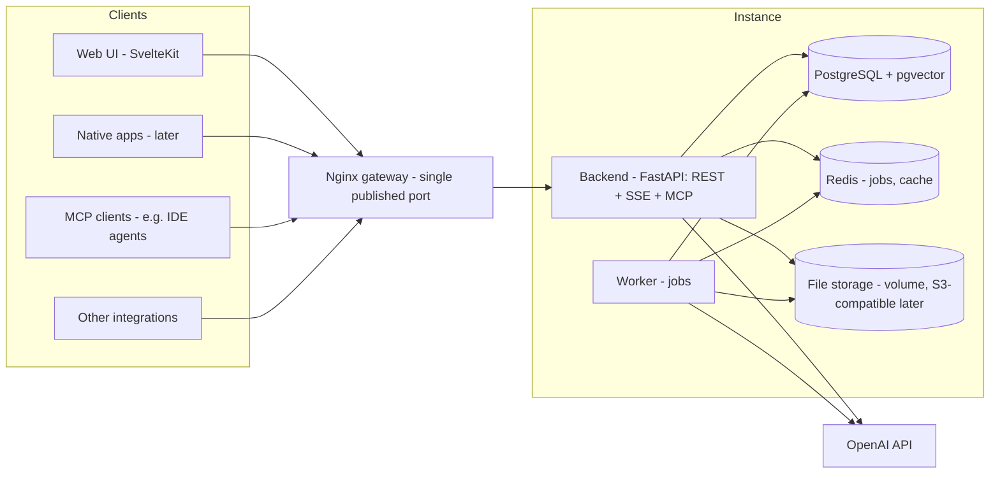

# Fidus — Architecture Overview

Status: the scaffold, the tasks module with in-app reminders, chat Stages 1–3, chat attachments and action-decision follow-up (`Refs #51–#52`), Files Stages 1–2, the audio module (`Refs #20`), personal access tokens and the MCP server (`Refs #22`), usage counters, structured logging, backup scripts and the security review (`Refs #23`) are implemented. OAuth remains design only. Update this file together with the code.

## 0. Implemented in the scaffold
- Compose services: `gateway`, `frontend`, `backend`, `worker`, `scheduler`, `db`, `redis` and the one-shot `migrate` service that `backend`, `worker` and `scheduler` wait for. Networks: `edge` (gateway only), `internal` (no outbound route), `egress` (backend and worker, for the OpenAI API); the scheduler only needs Redis on `internal`.
- Auth: fastapi-users with an opaque, random token in an httpOnly, SameSite=Lax cookie (`fidus_session`) and a readable double-submit CSRF cookie (`fidus_csrf`). Only the token's SHA-256 hash is stored in the database. State-changing requests carrying a session cookie must echo the CSRF token in `X-CSRF-Token`; the Origin check against `APP_URL` remains in place. Login sets both cookies and logout clears both and deletes its session row; `POST /api/v1/auth/logout-all` does the same while revoking all sessions for the current user. Sessions expire after `session_lifetime_seconds` (14 days); `sessions.purge_expired` runs daily at 03:15 UTC. Admins deactivate and reactivate users from `/admin` (`PATCH /api/v1/admin/users/{id}`); deactivation revokes all of the user's sessions. The first registered user becomes admin (`is_superuser`, exposed as `role`); registrations are serialized with an advisory lock. `REGISTRATION_MODE=closed` rejects further registrations; `invite-only` requires an admin-created invitation after the first user. Invitation tokens are shown once, stored as SHA-256 hashes, and expire after a configurable period (7 days by default, at most 30). Admins manage invitations in `/admin` and through the API.
- Login and registration are rate limited by client IP and account identifier using Redis fixed-window counters (`AUTH_RATE_LIMIT_ATTEMPTS`, `AUTH_RATE_LIMIT_WINDOW_SECONDS`). Identifiers are salted and hashed before becoming Redis keys. If Redis is unavailable, authentication fails open and a generic warning is logged so an outage does not prevent sign-in; this means rate limits are temporarily unavailable during that outage.
- Chat streaming, file uploads and audio memo uploads have separate per-user Redis fixed-window limits (`CHAT_RATE_LIMIT_*`, `FILE_UPLOAD_RATE_LIMIT_*`, `TRANSCRIPTION_RATE_LIMIT_*`). The user id is salted and hashed before it becomes part of a Redis key. Exceeded limits return HTTP 429 with `Retry-After`; these limits fail open with a generic warning if Redis is unavailable.
- The gateway trusts forwarded client addresses only from IPs/CIDRs in `TRUSTED_PROXIES` (empty by default). It rewrites `X-Real-IP` and `X-Forwarded-For` to the resolved client address. The backend does not enable Uvicorn proxy-header handling; the auth rate limiter accepts `X-Real-IP` only when its direct peer is a private or loopback address.
- Personal access tokens (`Refs #22`): `api_tokens` is a user-owned table with a forced policy. Only the SHA-256 hash and a short display prefix are stored; the secret (`fidus_pat_…`) is returned once at creation. Tokens carry scopes, expire after 90 days by default (1 to 365 days), record last use (written at most once a minute) and are revoked by setting `revoked_at`; a user can hold at most 25 active tokens. Tokens are created, listed and revoked through cookie-authenticated `POST/GET /api/v1/tokens` and `DELETE /api/v1/tokens/{id}` (so a token cannot mint tokens) and managed on the settings page `/settings/tokens`.
- MCP server (`Refs #22`): `POST /mcp` implements MCP streamable HTTP with JSON responses only, see section 12. Bearer authentication applies to `/mcp` only; REST routes keep accepting only the cookie session. Requests under `/mcp` skip the cookie CSRF check because session cookies are ignored there; the Origin check stays. Authenticated requests are limited per token (`MCP_RATE_LIMIT_REQUESTS` per `MCP_RATE_LIMIT_WINDOW_SECONDS`) and failed token attempts per client address with the auth limiter settings; like the auth limiter, the counters fail open when Redis is unavailable.
- Audit: token creation and revocation (actor `user`, actions `token.create` / `token.revoke`), MCP writes (actor `mcp`, actions `mcp.create_task` / `mcp.complete_task`, with the token id in `details`), agent writes/rejections and user memory edits/deletions are written to `audit_log` through `app.services.audit` in the same transaction as the change. The secret is never recorded. Users view their own agent activity at `/chat/audit`; admins view instance audit metadata in `/admin` through a reviewed admin-only database function.
- Not implemented yet: OAuth.
- Usage counters (`Refs #23`): `usage_records` is a user-owned table with a forced policy, one row per user, UTC day and metric (`chat_requests`, `input_tokens`, `output_tokens`, `transcription_seconds`, `embedding_chunks`, `mcp_calls`), unique on that triple and incremented by upsert in `app/services/usage.py`. The application role may select, insert and update it, not delete. Chat turns count one request plus the provider-reported tokens when the turn finishes or fails; the indexing service counts embedded chunks; transcription counts seconds of the re-encoded constant-bitrate segments; the MCP protocol handler counts each `tools/call` after the scope check. A counter failure is logged and never breaks the counted operation. `GET /api/v1/usage?days=` (1 to 90, default 30) returns totals and per-day amounts for the session user, shown on `/settings/usage`. Display only: no quota is enforced, storage is not counted and admins have no cross-user view.
- Logging (`Refs #23`): backend, worker and scheduler log one JSON object per line to stdout (`app/logging_config.py`). Fields come from an allow-list (ids, method, route template, status, duration); everything else passed as `extra` is dropped, messages are scrubbed of secret-shaped values, and exceptions are reduced to type and stack locations. A middleware assigns every HTTP request an id (a valid inbound `X-Request-ID` from the gateway is reused), returns it in the response header and writes one access line per request without query string or raw path; worker jobs use their task id. Tests assert that message text, search text, credentials and provider errors never appear.
- Hardening (`Refs #23`): passwords must be 12 to 256 characters. The gateway sets `X-Content-Type-Options`, `X-Frame-Options`, `Referrer-Policy`, `Permissions-Policy` and `Cross-Origin-Opener-Policy` on every response (including `/api` and `/mcp`), and the frontend sends a Content-Security-Policy. `tests/test_security_inventory.py` fails when a table with `user_id` lacks forced RLS and a policy, when a table without `user_id` is not reviewed, or when the SECURITY DEFINER set changes. Invitation registration functions and the reviewed admin-only invitation/audit functions are listed in section 5a. Findings and open items: [security-review.md](../security-review.md).
- Operations (`Refs #23`): `scripts/backup.sh` writes a `pg_dump` custom-format dump, a tar archive of the `files_data` volume, a manifest and checksums; `scripts/restore.sh` verifies them, refuses to overwrite a stack that holds data without `--force`, takes a safety backup, replaces database and files and re-runs the migrations. See [runbook.md](../runbook.md).
- Row-level security: `users` and `sessions` are intentionally not row-level-secured, because authentication has to look them up before any user context exists. The application role may only select, insert and update `users`, and only select, insert and delete `sessions`. `tasks`, `reminders`, `invitations`, `nodes`, `file_versions` and `api_tokens` are user-owned tables with forced policies. `module_settings` and `instance_settings` are instance-wide, have no `user_id` and intentionally no RLS policy; the application role may select, insert and update them. `app.user_id` is set with `set_config(..., true)`, the parameterizable form of `SET LOCAL`. The `migrate` service creates or refreshes the application role (`APP_DB_USER`, `APP_DB_PASSWORD`) before running Alembic. The reviewed SECURITY DEFINER exception `users_with_due_tasks(now)` returns only user ids for the reminder worker; PUBLIC execution is revoked and only the application role can execute it. `authenticate_api_token(token_hash)` is the second reviewed exception: bearer authentication has to resolve a token before any user context exists, so the function takes only the hash, returns the owner and scopes of an unrevoked, unexpired token of an active user, and updates `last_used_at`; PUBLIC execution is revoked. `admin_list_invitations()` and `admin_revoke_invitation(id)` require the active admin matching the current `app.user_id` and expose only active invitations. `admin_list_audit_entries(cursor, limit)` applies the same admin check and returns audit metadata while `audit_log` itself stays owner-scoped and append-only. All functions are pinned to `search_path = public`; PUBLIC execution is revoked and only the application role can execute them. The application role may select, insert and update `api_tokens` but not delete from it.
- Worker: taskiq with a Redis list broker, same image as the backend. `reminders.mark_due` runs every minute, finds users through the narrowly scoped `users_with_due_tasks` function, checks task module enablement, materializes reminders in each user's RLS context and publishes reminder ids to that user's Redis channel. `tasks.count_open` remains an example job. A Taskiq lifecycle hook refreshes a short-lived Redis heartbeat; the worker healthcheck requires a fresh heartbeat and verifies that Redis and the database answer.
- Scheduler: Taskiq's label schedule source reads recurring jobs from the same backend image and Redis broker. Its healthcheck verifies that the scheduler command is still running as PID 1.
- Modules: `GET /api/v1/modules` returns enabled registry entries for the session user; the sidebar renders them. Admins manage instance-wide enablement and invitations in `/admin`. Disabled modules are hidden from this endpoint; task APIs, file APIs and the reminder worker enforce module enablement. Disabling a module leaves its data untouched.
- Tasks and reminders: task CRUD, completion/reopen, soft delete and user-scoped reminder operations are implemented in shared services behind REST adapters. The task page provides localized task entry, filtering, editing and completion. The reminder banner loads active reminders and receives refreshed lists over per-user Redis-backed SSE; the stream uses short-lived user sessions and releases its Redis subscription on disconnect.
- Chat Stages 1–2 (`Refs #18`): fixed model configuration is loaded from `backend/app/ai/models.toml`; a provider interface and OpenAI chat provider are present. User-owned `conversations` and `messages` tables have forced RLS. REST routes provide conversation CRUD, message listing, full-text message search and `POST /api/v1/conversations/{id}/messages/stream` (SSE). The chat orchestrator stores each user turn before streaming, builds a budgeted history request, streams text deltas and stores a completed assistant turn with token counts. The web UI supports conversation management, streaming, Markdown and code. Chat attachments are **not implemented yet**. The streaming route is a plain SSE endpoint and is not described by the generated OpenAPI types.
- Chat Stage 3 (`Refs #18`): migration `0009` adds user-owned `memories`, `agent_settings`, `agent_actions` and `audit_log` with forced RLS; the application role may only select and insert `audit_log`. Memories are injected into every chat request; the chat orchestrator runs a bounded tool loop (four tool rounds, then a tools-free final round) over typed tools registered in `app/services/agent_tools.py`: `search_knowledge` (Files retrieval service, only while the files module is enabled), `search_conversations`, `web_search` (`WebSearchProvider`; the OpenAI implementation uses the Responses `web_search` tool through an injected client, a fake is used in tests), `remember`, `create_task` (only while the tasks module is enabled) and `create_file` / `update_file` (only while the files module is enabled). The file tools write `.txt`, `.md` and `.markdown` content through the Files service (`create_text_file`, `update_text_file`): same extension, UTF-8, NUL and size checks as an upload, a new file fails with `NAME_CONFLICT` instead of adding a version, names containing a path separator are rejected, and an update stores a new version of the user's own file and queues the usual indexing job. Search results given to the model carry `node_id` and `folder_id` so it can update a file it found; file citations in the chat link to the folder that holds the file. Sources gathered by tools become numbered citations stored on the assistant message and shown in the chat UI. Writes follow the per-user policy: by default they are stored as pending `agent_actions` and the turn ends until the user confirms or declines in the chat; with `allow` they run immediately. Each executed agent write adds an `audit_log` row in the same transaction. REST: `/memories` CRUD, `/agent/settings`, `/conversations/{id}/actions`, `/agent/actions/{id}/approve|reject`, `/agent/audit`, all gated by chat-module enablement. The web UI has a memory and assistant settings page at `/chat/memories`.
- Files Stage 1 (`Refs #19`): user-owned `nodes` and `file_versions` have forced RLS. The `files_data` named volume is mounted at `/data/files` for backend and worker and accessed through a local storage interface; REST routes support folders, streamed uploads, rename/move, soft deletion, version lists and attachment downloads.
- Files Stage 2 (`Refs #19`): user-owned `documents` and `chunks` also have forced RLS. Upload creates a pending document in the same transaction as its version; a post-commit callback queues extraction and indexing. The worker extracts UTF-8 text/Markdown, PDF or DOCX, chunks with overlap, embeds via the injected provider, and atomically replaces chunk rows. Failed extraction and embedding store stable error codes. Reindex queues the latest version. Search combines cosine vector ranking and PostgreSQL simple full-text ranking with reciprocal rank fusion, filtering deleted files and non-latest versions. `/files` shows indexing status, polls pending jobs, offers retry for failures and searches with source snippets. `pgvector>=0.3` supplies SQLAlchemy `Vector(1536)` and the asyncpg codec registered on database connections; the configured embedding dimension is 1536. Agent-created files, citations in chat answers and chat attachments remain unimplemented.
- Audio (`Refs #20`, #58): user-owned `memos` (forced RLS) hold an uploaded or browser-recorded recording in the storage interface (up to 100 MB; types webm, ogg, mp3, m4a/mp4, wav, flac, checked by extension and magic bytes). Upload queues `audio.transcribe_memo` after commit. The worker claims the memo under a row lock and ignores duplicate jobs while it is already transcribing. A scheduler checks every five minutes and requeues memos left pending or transcribing beyond `MEMO_TRANSCRIPTION_TIMEOUT_SECONDS` (default 30 minutes); this also retries queue failures, and recovery is scoped under each owner's RLS context. The worker re-encodes the audio with ffmpeg to 32 kbit/s mono MP3 segments of 10 minutes (about 2.4 MB each, far below the provider's 25 MB request limit), transcribes each segment through the `TranscriptionProvider` (`gpt-transcribe`) and joins the text. The transcript becomes a `documents` row with `source = 'memo'` (no node or file version) that goes through the same chunk, embed and hybrid retrieval path as files; knowledge search returns memo passages (`source = memo`, `memo_id`) while the audio module is enabled. Failures store stable codes (`AI_NOT_CONFIGURED`, `TRANSCRIPTION_FAILED`, `EMPTY_TRANSCRIPT`, `CORRUPT_AUDIO`, `FFMPEG_UNAVAILABLE`); a retry reuses an existing transcript and only re-indexes. Read-aloud synthesizes the transcript on demand through the `SpeechProvider` (Realtime API, `gpt-realtime-2.1-mini`, WAV 24 kHz mono) and caches the result per memo in storage. The `/audio` page records with MediaRecorder, uploads files, polls status, plays the original and the spoken transcript, retries and deletes. The ffmpeg binary is installed in the shared backend/worker image. Chat transcription input and read-aloud for chat messages are not implemented.
- Frontend: SvelteKit with adapter-node, server-side load of the user and modules, a generated OpenAPI type schema used by a shared `openapi-fetch` client, German and English catalogs with a typed key set.


## 1. Goals and constraints
- Web interface first. Native apps (macOS, iOS, iPadOS, Windows) come later as clients of the same API.
- Self-hostable in two ways with the same artifacts: locally on a developer machine, and on an own server or web hosting with Docker.
- Multiple users on one instance, with strict data separation.
- An MCP server and a documented REST API for later integrations.
- One instance-level OpenAI API key; models fixed in a config file.
- In-app reminders only.

## 2. System context



## 3. Components

| Component | Responsibility | Technology |
| --- | --- | --- |
| Gateway | Single host port, TLS (external proxy or certificates mounted into the gateway), routes `/` to the frontend, `/api` and `/mcp` to the backend; proxy buffering disabled and long timeouts for SSE | Nginx |
| Frontend | Web UI, generated TypeScript API client, i18n DE/EN; runs as its own container behind the gateway | SvelteKit (Node server), TypeScript |
| Backend | REST API, SSE streaming, MCP endpoint, auth, services | FastAPI, SQLAlchemy async, Alembic |
| Worker | Transcription, text extraction, chunking, embedding, reindexing, reminder scheduling | same codebase as backend, separate process (taskiq on Redis) |
| Database | Relational data, full-text search, vectors | PostgreSQL + pgvector |
| File storage | User files, uploaded audio, attachments | local `files_data` volume behind a storage interface; S3-compatible adapter later |
| Job queue and cache | Durable background jobs, rate-limit counters, short-lived cache | Redis |

Only the gateway publishes a host port. Frontend, backend, worker, database, Redis and storage live on internal networks.

## 4. Backend layering
```
routers (REST, SSE, MCP adapters)   thin: parse, authenticate, authorize, call a service
  -> services                       business logic, transactions, audit, quotas
     -> repositories                the only code that touches tables; every query takes a UserContext
     -> provider interfaces         LLM, transcription, embeddings, speech, web search, storage, clock
```
- **Capabilities** (search knowledge, read/write file, create/list/complete task, list conversations, ...) are defined once as typed service operations with input/output schemas and required scopes. The chat agent, REST routes and MCP tools are adapters over the same operations, so behavior, permissions and audit are identical.
- **Provider interfaces** exist so tests use fakes and the OpenAI-specific code stays in one package.
- Repositories require a `UserContext`; a query without one does not compile in the type system or fails in tests. PostgreSQL row-level security (section 5a) enforces the same separation inside the database.

## 5. Data model (initial)
All primary keys are ULIDs. Every user-owned table has `user_id` (indexed, foreign key), `created_at`, `updated_at`, and `deleted_at` where soft delete helps sync later.

| Area | Tables |
| --- | --- |
| Identity | `users`, `api_tokens` (hashed, scoped, expiring, last-used), `invitations` (created_by, token_hash, expires_at, used_at, used_by), `audit_log` |
| Chat | `conversations`, `messages` (role, content parts, tool calls, citations), `message_attachments` |
| Knowledge | `nodes` (folder or file tree), `file_versions`, `documents` (extracted text, source: upload, memo, agent), `chunks` (text, embedding vector, position), `memories` |
| Audio | `memos` (audio file, status, transcript document) |
| Tasks | `tasks` (title, notes, due_at, remind_at, done_at), `reminders` (state: pending, shown, dismissed) |
| Platform | `module_settings` (instance-wide and per user), `usage_records` (chat requests, tokens, transcription seconds, embedded chunks and MCP calls per user and day; display only; storage is not counted) |

The embedding dimension is fixed in the config file; changing the embedding model triggers a reindex job.

## 5a. Row-level security
- Every user-owned table has `ENABLE` and `FORCE ROW LEVEL SECURITY` with a policy matching its owner column (`user_id` or `created_by`) to `current_setting('app.user_id', true)`.
- `documents` and `chunks` use the same forced owner policy; service queries also include `user_id` filters.
- Instance-wide `module_settings` has no `user_id` and no RLS policy; it is available to the application role for admin-managed enablement.
- The backend connects with a dedicated application role that is neither superuser nor table owner and has no `BYPASSRLS`. Migrations run with a separate owner role.
- Each request transaction runs `SET LOCAL app.user_id = <id>` (set by the repository layer from the `UserContext`); with no value set, queries return no rows.
- Worker jobs carry the owning user id and set the same context. Reviewed SECURITY DEFINER functions use a fixed `public` search path and grant EXECUTE only to the application role. Invitation registration functions expose validity and atomic consumption by token hash; direct invitation queries remain scoped to `created_by`. Admin invitation functions require the active admin matching `app.user_id` and expose only unexpired, unused invitation ids/expiry or revoke an unused invitation. The admin audit function enforces the same check and exposes metadata from `audit_log` without changing its owner policy or append-only grants. `users_with_due_tasks(p_now)` returns only distinct user ids that have due, open, undeleted tasks without a reminder for that task and reminder time. The worker then returns to per-user RLS contexts for all reminder data access.
- Tests cover: missing context returns nothing, cross-user reads and writes fail, and the application role cannot bypass policies.

## 6. Authentication and multi-user
- Local accounts with fastapi-users. The first registered user becomes admin; afterwards registration is `open` (default), `invite-only` or `closed`, set by the admin: `REGISTRATION_MODE` is the default, and a mode saved in `/admin` (`PUT /api/v1/admin/registration`, stored in `instance_settings`) overrides it at runtime. In `invite-only` mode, an administrator creates a single-use invitation through the REST API; the registration link carries its token in the `invite` query parameter. All active admins can list and revoke outstanding invitations through the reviewed database functions. With `open` registration, every registered user can consume the instance's OpenAI key; operators exposing an instance to the internet should consider `invite-only` or `closed`. Roles: `admin`, `member`. Admins can search and paginate users, view the instance audit log, and change roles; an admin cannot deactivate or demote themselves, and the last active admin cannot be removed. Every administrative action (user changes, registration mode, module enablement, invitations) writes an `audit_log` row with actor `admin` in the acting admin's scope.
- Web: httpOnly, SameSite cookie session, CSRF protection for state-changing requests.
- API, MCP and later apps: bearer tokens. Personal access tokens (created in the UI, shown once, stored hashed, scoped, revocable) cover MCP clients and scripts. Native apps later use OAuth 2.0 authorization code with PKCE against the same backend; MCP clients that follow the MCP authorization specification use the same OAuth endpoints. Verify the current MCP authorization specification at implementation time.
- Scopes are capability-based (for example `knowledge:read`, `files:write`, `tasks:write`, `chat:use`). A token never exceeds its user's permissions.
- Rate limits on authentication and expensive user operations (counters in Redis). Usage is recorded per user and day and displayed to the user; there is no admin overview and no token or audio-minute quota enforcement in the MVP.
- An admin can manage users and modules but cannot read another user's conversations, files or memos.

## 7. Chat and agent
- Orchestrator loop (implemented): user message -> inject durable memories -> model call with registered tools -> execute read tools through services and feed delimited results back -> stream result. File retrieval and web results are cited through tool results; the model is told to cite them as `[n]`.
- Streaming to the browser via Server-Sent Events: `message`, `delta`, `tool`, `citations`, `action` and `done`/`error` events. Approving or rejecting a pending action starts a follow-up assistant turn; its outcome is sent as system context. Resuming a dropped stream by message id is not implemented because partial assistant output is not persisted.
- Tools are the capabilities from section 4 filtered by the user's scopes. Tool output and retrieved content are untrusted: they are delimited in prompts and cannot grant permissions. Write tools are attributed to the user and written to `audit_log`; a per-user policy chooses "ask before write" (default) or "allow". Implemented write tools are `remember`, `create_task`, `create_file` and `update_file` (audit actions `agent.<tool>`, target type `file` for the file tools); the file tools are not exposed over MCP, and scope filtering by token is not implemented for the chat agent.
- Attachments (`Refs #51`) are stored as owner-scoped blobs with a forced-RLS metadata row. PDF, plain text, Markdown, PNG, JPEG and WebP are accepted at up to 10 MiB each, with at most five per message. Extracted text is bounded and delimited as untrusted context. The provider interface carries image data URLs to the OpenAI Responses adapter; images are not text-extracted.
- Web search uses the provider's hosted search behind the `WebSearchProvider` interface. The backend fetches no pages itself, so nothing is requested from private address ranges; the answer is truncated and result links are limited to `http` and `https`.
- Memory: the conversation history is searchable (`search_conversations`); durable facts are stored as `memories` (at most 200, 1000 characters each) that the user can view, add, edit and delete; the agent can propose new ones through `remember`.

## 8. Knowledge pipeline (RAG)
Files Stage 1 (`Refs #19`) stores uploaded versions and provides the browser and download paths. Stage 2 implements upload ingestion, extraction, indexing and retrieval:
1. Ingest: upload creates a `documents` row in the file transaction; an after-commit callback queues `files.index_document`. Queue failures are logged and leave the row pending for retry.
2. Extract: bounded UTF-8 text/Markdown, PDF (maximum 500 pages; encrypted PDFs fail) and DOCX extraction. Error details are stable codes; file contents are treated as untrusted.
3. Chunk and embed: chunk size 1200 characters, overlap 200 characters, batches up to 64 embeddings, configured dimension 1536. Chunk replacement is transactional and failures do not expose provider exception text.
4. Retrieve: cosine vector top-k and PostgreSQL simple full-text top-k are merged by reciprocal rank fusion (`k=60`), scoped by owner, and exclude soft-deleted files and old versions. Results include source file, version, chunk position and snippet.
5. Update: a newer version is searchable only when its indexing is ready and removes stale chunks; soft deletion removes document text and chunks from search.

Chat uses this retrieval through the `search_knowledge` tool and cites passages. Memo transcripts (`source = 'memo'`) use the same chunking, embedding and retrieval. Not implemented: agent-created files.

## 9. Audio
- Browser records with MediaRecorder and uploads; file upload uses the same path.
- The worker transcribes through the provider interface. The transcription API limits file size (25 MB per request at the time of writing; verify), so the worker splits long audio with ffmpeg into segments and merges the transcript.
- The transcript becomes a `document` (searchable, citable) linked to the `memo`.
- Text-to-speech is generated on demand for a memo transcript and cached per memo (up to 12000 characters). Caching per chat message is not implemented.
- Models are fixed in `models.toml`: transcription `gpt-transcribe`; speech `gpt-realtime-2.1-mini` over the Realtime API, because the `/v1/audio/speech` models (`tts-1`, `tts-1-hd`, `gpt-4o-mini-tts`) shut down on 2027-01-06 according to the OpenAI documentation.

## 10. Tasks and reminders
- `tasks` hold title, optional notes, due time, optional reminder time, completion time and a soft-delete timestamp. Task queries are scoped to the authenticated user and omit soft-deleted tasks. Lists filter open, done or all tasks and paginate by `(created_at, id)`.
- `reminders` are per-user rows with pending, shown or dismissed state. Once a minute, `reminders.mark_due` finds users with work through `users_with_due_tasks`, materializes each due task reminder idempotently, and publishes `{"reminder_ids": [...]}` to `reminders:{user_id}` in Redis. Completing or deleting a task, or changing its reminder time, dismisses pending reminders.
- `GET /api/v1/reminders/stream` sends the active reminder list on connect, then refreshes it after Redis notifications; a keepalive comment is sent every 20 seconds. The browser banner reconnects with backoff and supports explicit dismissal. No e-mail or push in the MVP.
- Reminder state survives reloads; dismissing is explicit. Disabling the tasks module blocks the APIs and scheduled job while preserving stored rows.

## 11. REST API
- Prefix `/api/v1`, OpenAPI generated from the code, TypeScript types generated from the schema and consumed by a shared `openapi-fetch` client for browser and server requests.
- Tasks REST operations: `POST/GET /tasks`, `GET/PATCH/DELETE /tasks/{id}`, `POST /tasks/{id}/complete`, `POST /tasks/{id}/reopen`, `GET /reminders`, `POST /reminders/{id}/dismiss`, and `GET /reminders/stream`. All are authenticated and gated by tasks-module enablement.
- Files Stage 1 (`Refs #19`): `GET /files/nodes`, `POST /files/folders`, `POST /files/upload`, `PATCH/DELETE /files/nodes/{id}`, `GET /files/nodes/{id}/download`, and `GET /files/nodes/{id}/versions`. Routes are authenticated and gated by files-module enablement; upload and node reads are user-scoped.
- Chat Stage 3 (`Refs #18`): `GET/POST /memories`, `PATCH/DELETE /memories/{id}`, `GET/PUT /agent/settings`, `GET /conversations/{id}/actions`, `POST /agent/actions/{id}/approve` and `/reject`, `GET /agent/audit`. All are authenticated, user-scoped and gated by chat-module enablement; writes use CSRF protection.
- Administration: `GET /admin/users?q=&limit=&cursor=` returns a cursor-paginated, optionally email-filtered user page; `GET /admin/audit?limit=&cursor=` returns cursor-paginated audit metadata across the instance through the reviewed admin-only function. Both require an active admin. `/invitations` list and revoke now apply across admins through the reviewed functions; creation remains actor-attributed.
- Chat attachments (`Refs #51`): `POST /conversations/{id}/attachments` accepts one bounded PDF, text, Markdown or image upload. `POST /conversations/{id}/messages/stream` binds up to five owner-scoped attachment ids to a user message. `POST /conversations/{id}/actions/{action_id}/continue` starts a follow-up SSE turn after a decision. All are authenticated, chat-module gated and user-scoped.
- Files Stage 2 (`Refs #19`): `GET /files/nodes/{id}/document`, `POST /files/nodes/{id}/reindex`, and `GET /knowledge/search?q=&limit=` provide indexing status, latest-version retry and scoped hybrid search. All are authenticated and gated by files-module enablement; writes use CSRF protection.
- Audio (`Refs #20`): `GET/POST /audio/memos`, `GET/PATCH/DELETE /audio/memos/{id}`, `POST /audio/memos/{id}/retry`, `GET /audio/memos/{id}/audio` and `POST /audio/memos/{id}/speech`. All are authenticated and gated by audio-module enablement; writes use CSRF protection.
- Cursor pagination, consistent error shape, idempotency keys for create operations, request ids in responses and logs.
- Change feed for later offline clients: list endpoints support `updated_since` and tombstones (`deleted_at`). Sync itself is out of scope for the MVP.

## 12. MCP server
- Implemented (`Refs #22`) in the backend at `/mcp` as a minimal Streamable HTTP server (protocol versions 2025-06-18, 2025-03-26, 2024-11-05): `POST` carries one JSON-RPC message and answers with `application/json`, notifications get `202`, `GET` and `DELETE` return `405` (no server stream, no sessions), batches are rejected. The official `mcp` SDK is not used: its streamable-HTTP app is a separate ASGI application with its own session manager and authentication, which does not share this app's per-request, row-level-secured user sessions, rate limiting and service wiring, and it would add a locked dependency tree for a tools-only server. The gateway already routes `/mcp` unbuffered, so a server stream can be added later.
- Authentication is a personal access token in `Authorization: Bearer`. Missing, unknown, expired, revoked or inactive-owner tokens get `401` with `WWW-Authenticate: Bearer`; rate-limited requests get `429` with `Retry-After`.
- Tools call the same service operations as the REST routes and return the REST response models: `list_tasks` (`tasks:read`), `create_task` and `complete_task` (`tasks:write`), `search_knowledge` (`files:read`, hybrid retrieval over indexed files), `list_conversations` and `search_conversations` (`chat:use`). `tools/list` shows only tools whose scope the token holds and whose module is enabled. `tools/call` returns a JSON-RPC error for an unknown tool or invalid arguments (`-32602`), a missing scope (`-32001`, `INSUFFICIENT_SCOPE`) or a disabled module (`-32002`, `MODULE_DISABLED`); domain failures such as `TASK_NOT_FOUND` come back as results with `isError: true`. Each call runs in one transaction scoped to the token's user.
- Contract tests cover `initialize`, `tools/list`, `tools/call`, authentication failures, scope denial, module guard, rate limiting and cross-user isolation, and assert that every tool maps to an existing REST operation with a known scope and module.
- Not implemented: file read/write tools, `ask_assistant`, resources and OAuth for MCP clients.

## 13. Modules
- Registry in the backend declares `key`, name key (i18n), icon, routes, required scopes, dependencies (none unconditional). The sidebar is generated from enabled entries in `GET /api/v1/modules` for the current user.
- Instance-wide enablement is stored in the non-user-owned `module_settings` table and managed by admins through `/admin` and `/api/v1/admin/modules`; a missing row means enabled. Per-user visibility follows scopes. API route dependencies and worker jobs enforce disabled state, and module data remains untouched. The reminder worker calls `ensure_module_enabled("tasks")` before work.
- Initial modules: chat, files, tasks, audio. Files Stage 1 (`Refs #19`) supplies the folder browser, versioned uploads and downloads. Later: calendar and others as additional modules.

## 14. Deployment topologies
| Topology | Description |
| --- | --- |
| Local | `./start.sh`: Docker Compose, gateway on `localhost:${APP_PORT}`, secrets generated into `.env` |
| Own server or web hosting | The same Docker Compose configuration, behind TLS (external reverse proxy forwarding to the Nginx gateway, or certificates mounted into the gateway). Config: `APP_URL`, `COOKIE_SECURE=true`, trusted proxy list. A hosting environment without Docker is not supported |

Operations: health endpoints (`/health`, `/api/v1/health`), structured JSON logs without sensitive content, backups with `scripts/backup.sh` (a `pg_dump` and the `files_data` named volume, which holds user file blobs), restore, upgrade, rollback and secret rotation as in [runbook.md](../runbook.md), migrations run by a one-shot service before the backend starts. Set `TRUSTED_PROXIES` to the comma-separated IPs/CIDRs of the reverse proxy hops that connect to the gateway; leave it empty when no upstream proxy is used. Nginx applies recursive `X-Forwarded-For` resolution only to those trusted hops and forwards the resolved address as a single value. The backend rate limiter trusts `X-Real-IP` only from its private Docker-network peer.

## 15. Security summary
- Data separation by `user_id` in every repository call and by PostgreSQL row-level security, tested with cross-user negative tests.
- Secrets only in environment variables; tokens stored hashed; the OpenAI key never reaches the browser.
- Upload validation checks attachment type signatures, size and filename; uploaded content is never executed. Extracted attachment text is passed to the model only as delimited untrusted content.
- Prompt-injection posture: retrieved and fetched content is untrusted; write tools need approval by default; tools are typed and registered, no raw SQL or shell.
- Audit log for agent writes, token creation and administrative actions.

## 16. Delivery order
1. Scaffold: backend, frontend, Compose, CI, auth, module registry, tests.
2. Chat: conversations, streaming, markdown rendering, provider interface.
3. Files and RAG: tree, upload, extraction, embeddings, retrieval with citations.
4. Audio: recording, upload, transcription, TTS.
5. Tasks and in-app reminders.
6. API tokens, scopes, MCP server, contract tests.
7. Hardening: usage counters, backups, structured logs, security review, documentation (implemented); first release (published by the maintainer).

## 17. Decisions
- Gateway: Nginx.
- Job queue and cache: Redis.
- Frontend: SvelteKit Node server in its own container behind the gateway.
- Row-level security in PostgreSQL from the start.
- Deployment only through the provided Docker configuration, locally and on an own server or web hosting.
- Default registration mode: `open`.
- Quotas: usage display only, no enforcement in the MVP.

## 18. Open points
- Chunking parameters, retrieval defaults and exact model identifiers (decided by tests and current provider documentation).
- Admin-configurable quota enforcement as a later feature.
