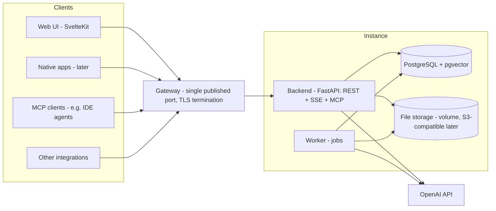

# Fidus — Architecture Overview

Status: design. Nothing described here is implemented until the scaffold lands; update this file together with the code.

## 1. Goals and constraints
- Web interface first. Native apps (macOS, iOS, iPadOS, Windows) come later as clients of the same API.
- Self-hostable in two ways with the same artifacts: locally on a developer machine, and on an own server or web hosting with Docker.
- Multiple users on one instance, with strict data separation.
- An MCP server and a documented REST API for later integrations.
- One instance-level OpenAI API key; models fixed in a config file.
- In-app reminders only.

## 2. System context



## 3. Components

| Component | Responsibility | Technology |
| --- | --- | --- |
| Gateway | Single host port, TLS (bundled profile or external proxy), routes `/` to the frontend, `/api` and `/mcp` to the backend; SSE-safe timeouts | Caddy or Nginx (open decision) |
| Frontend | Web UI, generated TypeScript API client, i18n DE/EN | SvelteKit, TypeScript |
| Backend | REST API, SSE streaming, MCP endpoint, auth, services | FastAPI, SQLAlchemy async, Alembic |
| Worker | Transcription, text extraction, chunking, embedding, reindexing, reminder scheduling | same codebase as backend, separate process |
| Database | Relational data, full-text search, vectors | PostgreSQL + pgvector |
| File storage | User files, uploaded audio, attachments | local volume behind a storage interface; S3-compatible adapter later |
| Job queue | Durable background jobs | PostgreSQL-backed queue (no extra service); Redis is the alternative if throughput requires it (open decision) |

Only the gateway publishes a host port. Backend, worker, database and storage live on internal networks.

## 4. Backend layering
```
routers (REST, SSE, MCP adapters)   thin: parse, authenticate, authorize, call a service
  -> services                       business logic, transactions, audit, quotas
     -> repositories                the only code that touches tables; every query takes a UserContext
     -> provider interfaces         LLM, transcription, embeddings, speech, web search, storage, clock
```
- **Capabilities** (search knowledge, read/write file, create/list/complete task, list conversations, ...) are defined once as typed service operations with input/output schemas and required scopes. The chat agent, REST routes and MCP tools are adapters over the same operations, so behavior, permissions and audit are identical.
- **Provider interfaces** exist so tests use fakes and the OpenAI-specific code stays in one package.
- Repositories require a `UserContext`; a query without one does not compile in the type system or fails in tests. PostgreSQL row-level security is a defense-in-depth option (open decision).

## 5. Data model (initial)
All primary keys are ULIDs. Every user-owned table has `user_id` (indexed, foreign key), `created_at`, `updated_at`, and `deleted_at` where soft delete helps sync later.

| Area | Tables |
| --- | --- |
| Identity | `users`, `api_tokens` (hashed, scoped, expiring, last-used), `invitations`, `audit_log` |
| Chat | `conversations`, `messages` (role, content parts, tool calls, citations), `message_attachments` |
| Knowledge | `nodes` (folder or file tree), `file_versions`, `documents` (extracted text, source: upload, memo, agent), `chunks` (text, embedding vector, position), `memories` |
| Audio | `memos` (audio file, status, transcript document) |
| Tasks | `tasks` (title, notes, due_at, remind_at, done_at), `reminders` (state: pending, shown, dismissed) |
| Platform | `module_settings` (instance-wide and per user), `usage_records` (tokens, audio minutes per user and day) |

The embedding dimension is fixed in the config file; changing the embedding model triggers a reindex job.

## 6. Authentication and multi-user
- Local accounts with fastapi-users. The first registered user becomes admin; afterwards registration is `invite-only` (default), `open` or `closed`, set by the admin. Roles: `admin`, `member`.
- Web: httpOnly, SameSite cookie session, CSRF protection for state-changing requests.
- API, MCP and later apps: bearer tokens. Personal access tokens (created in the UI, shown once, stored hashed, scoped, revocable) cover MCP clients and scripts. Native apps later use OAuth 2.0 authorization code with PKCE against the same backend; MCP clients that follow the MCP authorization specification use the same OAuth endpoints. Verify the current MCP authorization specification at implementation time.
- Scopes are capability-based (for example `knowledge:read`, `files:write`, `tasks:write`, `chat:use`). A token never exceeds its user's permissions.
- Rate limits on auth endpoints; per-user quotas for tokens and audio minutes (configurable, off by default for self-hosting).
- An admin can manage users and modules but cannot read another user's conversations, files or memos.

## 7. Chat and agent
- Orchestrator loop: user message -> retrieve context (memory, RAG) -> model call with registered tools -> execute tool calls through services -> stream result.
- Streaming to the browser via Server-Sent Events: tokens, tool-call status, citations, final message id. Reconnect resumes by message id.
- Tools are the capabilities from section 4 filtered by the user's scopes. Tool output and retrieved content are untrusted: they are delimited in prompts and cannot grant permissions. Write tools (file, task) are attributed to the user and written to `audit_log`; a per-user policy chooses "ask before write" (default) or "allow".
- Web search uses the provider's search capability behind the `WebSearch` interface; fetched pages are treated as untrusted and size-limited; outbound fetching is protected against requests to private address ranges.
- Memory: the conversation history is searchable; durable facts are stored as `memories` that the user can view, edit and delete.

## 8. Knowledge pipeline (RAG)
1. Ingest: upload or agent-created file is stored, a `file_version` row is created, a job is queued.
2. Extract: text extraction per type (plain text, Markdown, PDF, DOCX, images later); failures are visible in the UI.
3. Chunk and embed: chunking with overlap, embeddings via the provider interface, rows in `chunks`.
4. Retrieve: hybrid search (vector similarity plus PostgreSQL full-text), scoped by `user_id`, returned with source references for citations.
5. Update: new file version or deletion removes stale chunks.
Chunk size, overlap and top-k are configuration values with documented defaults chosen by tests, not assumptions.

## 9. Audio
- Browser records with MediaRecorder and uploads; file upload uses the same path.
- The worker transcribes through the provider interface. The transcription API limits file size (25 MB per request at the time of writing; verify), so the worker splits long audio with ffmpeg into segments and merges the transcript.
- The transcript becomes a `document` (searchable, citable) linked to the `memo`.
- Text-to-speech is generated on demand and cached per message.

## 10. Tasks and reminders
- Tasks with `due_at` and optional `remind_at`. The worker marks reminders as due; the web UI receives them over an SSE channel and shows them in-app. No e-mail or push in the MVP.
- Reminder state is per user and survives reloads; dismissing is explicit.

## 11. REST API
- Prefix `/api/v1`, OpenAPI generated from the code, TypeScript client generated from the schema for the frontend and for later apps.
- Cursor pagination, consistent error shape, idempotency keys for create operations, request ids in responses and logs.
- Change feed for later offline clients: list endpoints support `updated_since` and tombstones (`deleted_at`). Sync itself is out of scope for the MVP.

## 12. MCP server
- Mounted in the backend at `/mcp` using the Streamable HTTP transport, reusing authentication, scopes, quotas and audit.
- Tools map to capabilities: `search_knowledge`, `list_files`, `read_file`, `write_file`, `create_task`, `list_tasks`, `complete_task`, `list_conversations`, `ask_assistant` (optional). Tool lists are filtered by token scopes.
- Resources expose files and documents for clients that support them.
- Contract tests assert that every MCP tool has an equivalent REST operation and enforces the same scope and user scoping.

## 13. Modules
- Registry in the backend declares `key`, name key (i18n), icon, routes, required scopes, dependencies (none unconditional). The sidebar is generated from `GET /api/v1/modules` for the current user.
- Instance-wide enablement by an admin; per-user visibility follows scopes. Disabled modules are blocked in API, MCP, worker and UI, and keep their data.
- Initial modules: chat, files, tasks. Later: calendar and others as additional modules.

## 14. Deployment topologies
| Topology | Description |
| --- | --- |
| Local | `./start.sh`: Docker Compose, gateway on `localhost:${APP_PORT}`, secrets generated into `.env` |
| Own server | Same Compose files behind TLS. Option A: bundled Caddy profile with automatic certificates. Option B: external reverse proxy forwarding to the gateway. Config: `APP_URL`, `COOKIE_SECURE=true`, trusted proxy list |
| Web hosting without Docker | Not supported by this design: it requires PostgreSQL with pgvector, a worker process and a long-lived backend. A managed-PostgreSQL variant (backend and worker as plain processes) is possible; to be decided |

Operations: health endpoints (`/health`, `/api/v1/health`), structured JSON logs without sensitive content, backup runbook (`pg_dump` plus file volume), upgrade and rollback as in `docs/releases.md`, migrations run by a one-shot service before the backend starts.

## 15. Security summary
- Data separation by `user_id` in every repository call, tested with cross-user negative tests.
- Secrets only in environment variables; tokens stored hashed; the OpenAI key never reaches the browser.
- Upload validation (type, size, filename), isolated text extraction, no execution of uploaded content.
- Prompt-injection posture: retrieved and fetched content is untrusted; write tools need approval by default; tools are typed and registered, no raw SQL or shell.
- Audit log for agent writes, token creation and administrative actions.

## 16. Delivery order
1. Scaffold: backend, frontend, Compose, CI, auth, module registry, tests.
2. Chat: conversations, streaming, markdown rendering, provider interface.
3. Files and RAG: tree, upload, extraction, embeddings, retrieval with citations.
4. Audio: recording, upload, transcription, TTS.
5. Tasks and in-app reminders.
6. API tokens, scopes, MCP server, contract tests.
7. Hardening: quotas, backups, documentation, first release.

## 17. Open decisions
- Gateway: Caddy or Nginx.
- Job queue: PostgreSQL-backed or Redis.
- Frontend serving: SvelteKit Node server behind the gateway, or static build served by the gateway.
- Row-level security in PostgreSQL as additional isolation.
- Managed-PostgreSQL variant without Docker for shared web hosting.
- Default registration mode and quota defaults.
